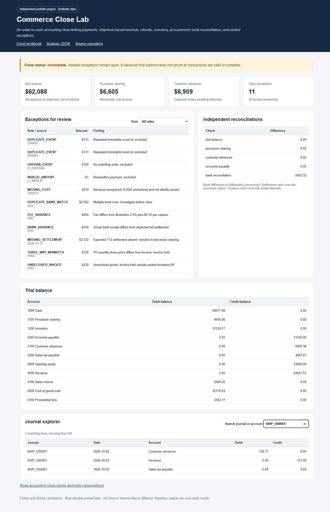

# Commerce Close Lab

A reproducible first-party e-commerce accounting close spanning payments, revenue cutoff, returns, inventory, procurement and bank reconciliation. **All data is synthetic**. This is an independent portfolio project.



## Start with the decision

**Do not mark the close complete.** The trial balance reconciles, but 11 deliberately seeded exceptions remain unresolved. The model distinguishes a mathematically balanced ledger from a complete, supportable accounting close.

The October case processes 600 orders, accepts 625 payment events, and generates 4,183 journal lines. Net recognized revenue is $62,088.26. Customer advances of $6,909.38 remain for captured orders awaiting shipment; $6,604.80 remains in processor clearing. These are case-study outputs, not achieved business results. COGS and profit remain provisional because one shipped order lacks cost evidence.

## Review in five minutes

1. Open [the Excel workbook](workbooks/model.xlsx): Summary links to the calculated trial balance.
2. Inspect `Journals`: real **VLOOKUP** formulas map accounts to names; signed entries separate captures, shipments, refunds, settlements and procurement.
3. Inspect `Trial balance`: **SUMIFS** calculates debits, credits, and account balances from journal detail.
4. Inspect `Pivot review`: a **native Excel PivotTable** provides a second view of debit and credit activity by account.
5. Review `Exceptions`, [the close memo](outputs/close_memo.md), and [the accounting walkthrough](docs/WALKTHROUGH.md).

GitHub displays HTML as source. Download and open `outputs/dashboard.html`, or run the local server below. The dashboard supports exception filtering and journal/account search.

## Run

Python 3.11 or later; no external Python libraries, credentials, or services required.

```bash
python run.py
python -m unittest discover -s tests -v
python -m http.server 8000
```

Open `http://localhost:8000/outputs/dashboard.html`. `python run.py` rebuilds the synthetic source CSVs, journal detail, trial balance, SQLite database, exception register, dashboard, and close memo.

The checked-in Excel workbook corresponds to the default seeded data. It recalculates its trial balance and account mappings from the journal detail. Regenerating Python outputs does not silently change workbook input cells; see [the workbook guide](docs/WORKBOOK.md).

## Accounting flow

| Event | Debit | Credit |
|---|---|---|
| Payment capture | Processor clearing | Customer advances |
| Shipment | Customer advances | Revenue and sales tax payable |
| Merchandise shipped | Cost of goods sold | Inventory |
| Full-order refund | Sales returns and sales tax payable | Processor clearing |
| Resalable returned merchandise | Inventory | Cost of goods sold |
| Processor settlement | Cash and processing fee expense | Processor clearing |
| Matched, received supplier invoice | Inventory | Accounts payable |
| Supplier payment | Accounts payable | Cash |

The case assumes transfer of control at shipment under simplified contract terms. Real recognition policy depends on actual agreements and fulfillment obligations. Sales tax is a liability. Processor fees are an expense and do not reduce first-party gross revenue. Integer cents are used throughout Python and SQL; fee generation uses Python's deterministic rounding.

## Controls and exception treatment

- Duplicate immutable event IDs are excluded without double-posting. Distinct repeated same-kind order events are also rejected within this full-order scope.
- Nonpositive amounts, orphan events and amount mismatches are quarantined.
- Unshipped captured orders remain customer advances at cutoff.
- Missing cost is surfaced; no assumed zero cost is inserted into COGS.
- Settlement gross is checked against valid activity. Expected T+2 settlements are checked for completeness.
- Fees are compared with an illustrative 2.9% plus $0.30 per capture contract.
- Bank settlement keys must be unique; bank-to-processor amount mismatches remain open.
- PO quantity-times-price is checked against the invoice and receipt cutoff before inventory/AP posting.
- Every journal must balance before posting, and the trial balance is independently aggregated in SQL and Excel.

The default case has 11 open exception rows across 10 rules. Bank-to-book difference is **-$2,402.32**, including a duplicate bank row and a deliberately short deposit. Expected settlement cash stays in the books pending investigation; the model does not insert an unexplained reconciliation plug. A missing T+2 settlement remains in processor clearing. The exception amount column mixes affected transaction amounts and reconciliation differences, so **do not sum it as a loss estimate**.

## Validation

- 24 automated tests covering per-journal balance, total balance, cutoff, advances, AP, clearing, all seeded rules, replay idempotency, input immutability and mismatch handling.
- Independent native Excel recalculation agrees with Python for revenue, COGS, fees, advances, clearing, AP and book cash to within half a cent.
- Native Excel formula error scan completed; workbook includes a real PivotTable cache and definition.
- [Excel verification receipt](outputs/excel_verification.json).
- GitHub Actions tests on Python 3.11, 3.12 and 3.13; check the Actions tab for remote results.

## Boundaries

One first-party retailer, one currency, one month, full shipments and full refunds only. Returns are assumed resalable. No chargebacks, sales-tax remittances, partial captures, customer AR aging, intercompany, FX, inventory write-down provision or income-tax close is modeled. Suspense-account resolution, materiality judgments, human approval and correcting entries are intentionally not fabricated. Purchases with unresolved matching issues remain in the exception register rather than becoming silently approved entries.

## Files and provenance

`close.py` contains generation, controls and journal logic. `data/` contains five synthetic source extracts, seed 71. `sql/model.sql` defines trial-balance and unbalanced-journal views. `outputs/` contains journals, exceptions, analysis and memo. `workbooks/` contains the Excel model. The interactive dashboard is generated without external assets or analytics tracking.

The project responds to the accounting, controls, analytics and operational-accounting knowledge. It is not a statement of GAAP compliance, or an endorsed product.

MIT licensed.
